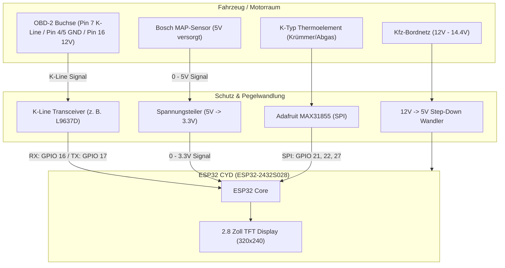

# VW 1.8T (AGU) Motronic M3.8.3 – ESP32 CYD Multi-Gauge 🚗💨

[](https://github.com/witnessmenow/ESP32-Cheap-Yellow-Display)
[](#)
[](#)
[](#)
[](https://www.arduino.cc/)
[](LICENSE)

Ein multifunktionales digitales Zusatzinstrument für Fahrzeuge der VAG-Gruppe mit dem beliebten **1.8T 20V (AGU)** Motor und **Bosch Motronic M3.8.3** Steuergerät (z. B. VW Golf 4, Audi A3 8L, Škoda Octavia 1U). 

Basierend auf dem kostengünstigen **ESP32 CYD ("Cheap Yellow Display" / ESP32-2432S028)** vereint dieses Projekt echte analoge Sensormessungen (Ladedruck, Abgastemperatur) mit Live-Motordaten direkt aus dem Steuergerät über die **K-Line (KW1281-Protokoll)**.

---

## 📸 Display-Layout (320x240 Landscape)

Das Display ist in 4 übersichtliche Quadranten unterteilt:

```
+-----------------------------------+-----------------------------------+
|         LADEDRUCK (bar)           |          ABGASTEMP (°C)           |
|                                   |                                   |
|              1.25                 |               845                 |
|                                   |     (wechselt zu ROT bei >900°C)  |
+-----------------------------------+-----------------------------------+
|        DREHZAHL (U/min)           |         KUEHLWASSER (°C)          |
|                                   |                                   |
|              3200                 |                90                 |
|      (über K-Line / KW1281)       |    (wechselt zu ROT bei >100°C)   |
+-----------------------------------+-----------------------------------+
```

---

## 🚀 Features

- **Echter Ladedruck (Boost)**:
  - Da der 1.8T AGU ab Werk keinen Ladedrucksensor besitzt (reine Luftmassen-Steuerung), wird ein externer **3-Bar MAP-Sensor** (z. B. Bosch) präzise über einen analogen Pin eingelesen und in Relativdruck (Ladedruck in Bar) umgerechnet.
- **Abgastemperatur (EGT)**:
  - Anschluss für ein **K-Typ Thermoelement** über den **MAX31855** SPI-Verstärker.
  - Dynamische Farbwarnung: Schaltet bei kritischen Temperaturen (**> 900 °C**) automatisch von Orange auf Warnrot um.
- **K-Line / KW1281 Diagnose-Schnittstelle**:
  - Nutzt `Serial2` des ESP32 mit 10.400 Baud zur Kommunikation mit dem Steuergerät via L9637D K-Line Transceiver.
  - Auslesen nativer ECU-Parameter wie Drehzahl (RPM) und Kühlmitteltemperatur.
- **Flackerfreie Anzeige**:
  - Non-blocking Architektur (`millis()`-Timer): Sensoren werden mit **20 Hz (50 ms)** erfasst, das Display wird mit **10 Hz (100 ms)** aktualisiert.

---

## 🛠 Benötigte Hardware

| Komponente | Beschreibung | Empfehlung / Hinweis |
| :--- | :--- | :--- |
| **ESP32 CYD** | ESP32-2432S028R | 2.8" TFT (320x240) mit Touchscreen & ESP32 |
| **MAP-Sensor** | 3-Bar oder 4-Bar Drucksensor | z. B. Bosch 0 281 002 437 o. Ä. (benötigt Spannungsteiler auf 3.3V) |
| **EGT-Verstärker** | MAX31855 Modul | SPI-Interface für K-Typ Thermoelement |
| **K-Typ Sensor** | Abgastemperaturfühler | M10x1 Einschweißgewinde für Krümmer/Downpipe |
| **K-Line Transceiver** | L9637D, SI9241A oder ISO-Board | Zur Anbindung von Pin 7 der OBD2-Buchse (12V Logik auf 3.3V) |
| **Spannungsversorgung** | 12V ➔ 5V Step-Down Konverter | Kfz-tauglich mit Filterung (z. B. LM2596 oder fertiger USB-Wandler) |
| **Widerstände** | Spannungsteiler für MAP-Signal | z. B. 2.2 kΩ und 3.3 kΩ (um max. 5V auf ~3.0V zu begrenzen) |

---

## 📌 Pinbelegung (ESP32 CYD)

| Signal / Sensor | ESP32 Pin | CYD Header / Hinweis |
| :--- | :--- | :--- |
| **MAP-Sensor (Signal)** | `GPIO 35` | Analoger Eingang (ADC1) – **Spannungsteiler nutzen!** |
| **MAX31855 DO (Data Out)** | `GPIO 22` | SPI MISO |
| **MAX31855 CS (Chip Select)**| `GPIO 21` | SPI Chip Select |
| **MAX31855 CLK (Clock)** | `GPIO 27` | SPI Clock |
| **K-Line RX** | `GPIO 16` | ESP32 Hardware `Serial2` RX (vom Transceiver) |
| **K-Line TX** | `GPIO 17` | ESP32 Hardware `Serial2` TX (zum Transceiver) |
| **Display (TFT)** | *intern* | Fest auf dem CYD verdrahtet (über `TFT_eSPI`) |

> [!WARNING]
> **5V-Sensoren und Kfz-Bordnetz:**  
> Die analogen Eingänge des ESP32 vertragen **maximal 3.3V**! Ein 5V MAP-Sensor darf **niemals direkt** mit dem GPIO verbunden werden. Verwende zwingend einen geeigneten Spannungsteiler oder Level-Shifter.

---

## 🔌 Schaltplan-Übersicht



---

## 💻 Software & Bibliotheken

Folgende Bibliotheken werden in der Arduino IDE benötigt:

1. **[TFT_eSPI](https://github.com/Bodmer/TFT_eSPI)** von Bodmer
2. **[Adafruit MAX31855](https://github.com/adafruit/Adafruit-MAX31855-library)** von Adafruit

### ⚙️ `TFT_eSPI` Konfiguration für das CYD

Damit das Display korrekt angesteuert wird, muss die `User_Setup.h` im Ordner der `TFT_eSPI`-Bibliothek (unter `Arduino/libraries/TFT_eSPI/`) für das CYD (ESP32-2432S028) angepasst werden:

```cpp
#define ILI9341_2_DRIVER     // Oder ST7789 je nach CYD Revision
#define TFT_WIDTH  240
#define TFT_HEIGHT 320
#define TFT_MISO 12
#define TFT_MOSI 13
#define TFT_SCLK 14
#define TFT_CS   15
#define TFT_DC    2
#define TFT_RST  -1
#define TFT_BL   21          // Backlight Pin
```
*(Alternativ kann die vordefinierte CYD-Setup-Datei eingebunden werden).*

---

## 📦 Installation

1. **Repository klonen:**
   ```bash
   git clone https://github.com/<DEIN-BENUTZERNAME>/Motronic-OBD-Gauge.git
   ```
2. **Arduino IDE vorbereiten:**
   - Installiere das **ESP32 Board-Package** (über den Boardverwalter: `esp32` von Espressif Systems).
   - Installiere die Bibliotheken `TFT_eSPI` und `Adafruit MAX31855`.
3. **Board-Einstellungen:**
   - Board: `ESP32 Dev Module`
   - Upload Speed: `115200` oder `921600`
   - Flash Frequency: `80MHz`
   - Partition Scheme: `Default 4MB with spiffs`
4. **Sketch öffnen & hochladen:**
   - Öffne `AGU_ESP32_Gauge.ino` in der Arduino IDE.
   - Verbinde das CYD per Micro-USB / USB-C und klicke auf **Upload**.

---

## 🧮 MAP-Sensor Kalibrierung

In `readSensors()` ist die Formel für den Ladedruck hinterlegt:

$$\text{Absolutdruck} = \frac{U_{\text{gemessen}}}{U_{\text{max}}} \cdot P_{\text{max}}$$
$$\text{Ladedruck (relativ)} = \text{Absolutdruck} - 1.013\,\text{bar}$$

> [!NOTE]
> Je nachdem, welchen Spannungsteiler du für den ADC verwendest und welcher MAP-Sensor verbaut ist (0.2–3.0 bar oder 0.5–4.0 bar), müssen die Koeffizienten in `readSensors()` ggf. an deine Sensor-Kennlinie angepasst werden.

---

## 🗺 Roadmap / Zukünftige Erweiterungen

- [ ] **KW1281 Protokoll-Stack vervollständigen**:
  - Implementierung des 5-Baud Slow-Init (0x01 Motor-ECU)
  - Abfrage der Messwertblöcke (MWB 001 / 002 / 003 für exakte Drehzahl, Ansauglufttemperatur, Zündwinkel, Einspritzzeit)
  - Keep-Alive / Acknowledgment-Handling
- [ ] **Touchscreen-Unterstützung**:
  - Umschalten zwischen verschiedenen Ansichten (z. B. 4er-Grid, Einzelwert-Großanzeige, Minimal-/Maximalwerte)
- [ ] **Fehlerspeicher (DTC)**:
  - Auslesen und Löschen des Motorsteuergeräte-Fehlerspeichers per Touch-Befehl
- [ ] **Gehäuse**:
  - STL-Dateien für einen 3D-Druck-Einsatz (z. B. für die mittlere Lüftungsdüse im Golf 4 / A3 8L)

---

## ⚠️ Disclaimer & Sicherheitshinweis

Dieses Projekt dient ausschließlich zu Hobby- und Tuning-Zwecken auf abgesperrten Strecken oder zu Testzwecken.
- Arbeiten an der Fahrzeugelektronik und am Abgastrakt erfordern Fachkenntnisse.
- Achte immer auf eine saubere Absicherung der Zuleitungen im Fahrzeug.
- Der Entwickler übernimmt keinerlei Haftung für Schäden am Fahrzeug, Steuergerät oder Motor!

---

## 📄 Lizenz

Dieses Projekt ist unter der [MIT License](LICENSE) lizenziert.
